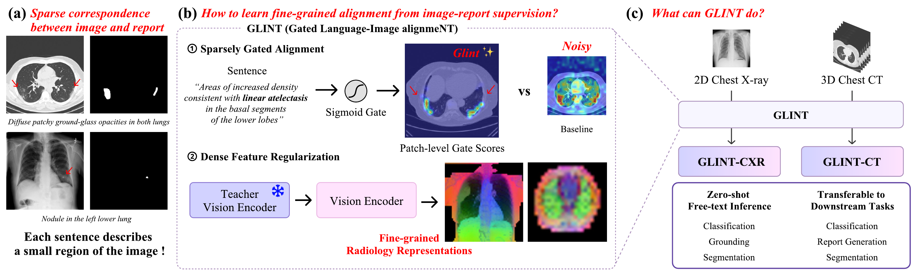
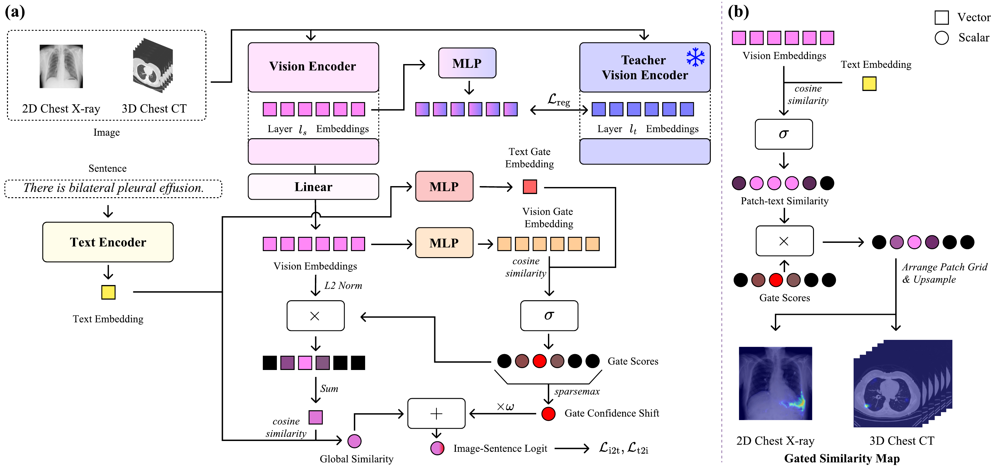

<div align="center">

# [NeurIPS 2026] GLINT: Sparsely Gated Vision-Language Alignment for Fine-Grained Radiology Representations

[📝 Paper](https://arxiv.org/abs/2606.03180) •
[🤗 GLINT-CXR](https://huggingface.co/Deepnoid/GLINT-CXR) •
[🤗 GLINT-CT](https://huggingface.co/Deepnoid/GLINT-CT) •
[🌐 Project Page](https://deepnoid-ai.github.io/GLINT/)

</div>

## Introduction



**GLINT** (**G**ated **L**anguage-**I**mage alignme**NT**) learns fine-grained radiology
representations from image-report pairs:

- **Sparsely Gated Alignment (SGA)** — a sigmoid gate in a separate gate embedding space
  activates only the patches relevant to each sentence, with a sparsemax-pooled
  gate-confidence shift.
- **Dense Feature Regularization (DFR)** — token-wise distillation to a frozen SSL teacher
  keeps patch features fine-grained.

One recipe for 2D chest X-ray (DINOv3 ViT-L @ 1024, MIMIC-CXR) and 3D chest CT
(V-JEPA 2.1 ViT-L @ 384 × 80 frames, CT-RATE).



> ⚠️ GLINT is released for research purposes only and is not intended for clinical use, including the diagnosis or
> treatment of any medical condition.

## Updates

- **2026-10-23:** Code and model checkpoints released.
- **2026-09-25:** GLINT is accepted to NeurIPS 2026 🎉 (7,900 / 30,709 = 25.73% acceptance rate)
- **2026-06-02:** Paper on [arXiv](https://arxiv.org/abs/2606.03180).

## Models

| Model | Backbone | Data | 🤗 Hub |
|---|---|---|---|
| GLINT-CXR | DINOv3 ViT-L/16 @ 1024 | MIMIC-CXR | [Deepnoid/GLINT-CXR](https://huggingface.co/Deepnoid/GLINT-CXR) |
| GLINT-CT | V-JEPA 2.1 ViT-L/16 @ 384, 80 frames | CT-RATE | [Deepnoid/GLINT-CT](https://huggingface.co/Deepnoid/GLINT-CT) |

```python
from transformers import AutoModel

model = AutoModel.from_pretrained("Deepnoid/GLINT-CXR", trust_remote_code=True)                     # VLM
vision = AutoModel.from_pretrained("Deepnoid/GLINT-CXR", trust_remote_code=True, vision_only=True)  # encoder only
```

- **Inference with similarity maps:** see the model cards
  ([GLINT-CXR](https://huggingface.co/Deepnoid/GLINT-CXR#usage) / [GLINT-CT](https://huggingface.co/Deepnoid/GLINT-CT#usage)).
- **`transformers==4.56.1`:** 5.x silently skips the DINOv3 vision weights.

## Setup

```bash
git clone https://github.com/deepnoid-ai/GLINT.git && cd GLINT
uv sync                # pretraining + zero-shot evaluation
uv sync --extra ft     # + fine-tuning baselines and report-generation metrics
```

- **CUDA:** the lock installs torch 2.11 for CUDA 13 (driver ≥ 580). With a CUDA 12 driver, install a cu12x torch build
  after `uv sync`.
- **W&B:** logging reads `WANDB_API_KEY` from `.env`.
- **GPUs:** the paper runs used 8 × H200; the sub-READMEs give the effective batch sizes.

| Variable | Used by |
|---|---|
| `DATA_ROOT` | datasets and manifests (required) |
| `OUTPUT_ROOT` | experiment outputs (default `./outputs`) |
| `PRETRAINED_DIR` | base and baseline encoder weights, RadBERT labeler (default `./pretrained`) |
| `DFR_CACHE_DIR` | cached-teacher mode (default `./dfr_cache`) |

## Repository structure

| Path | Contents |
|---|---|
| [`glint/`](glint/README.md) | Pretraining, zero-shot evaluation, report decomposition |
| [`ft/`](ft/README.md) | Downstream fine-tuning: classification, report generation, segmentation |
| 🤗 `data/` | Split ID lists ship with [GLINT-CXR](https://huggingface.co/Deepnoid/GLINT-CXR/tree/main/data) / [GLINT-CT](https://huggingface.co/Deepnoid/GLINT-CT/tree/main/data) |
| `common/` | Config / logging utilities |
| `docs/` | Project page and figures |

## Datasets

Download each dataset from its source under its own terms and lay it out under `DATA_ROOT` as in
[`glint/README.md`](glint/README.md) and [`ft/README.md`](ft/README.md).

## Acknowledgments

This work was supported by the Technology Innovation Program (RS-2025-02221011,
Development of Medical-Specialized Multimodal Hyperscale Generative AI Technology
for Global Integration) funded by the Ministry of Trade, Industry & Energy (MOTIE,
South Korea), and by the Advanced GPU Utilization Support Program funded by the
Korean government (Ministry of Science and ICT) (Project No. 02-26-91-0330).

## License

| Component | License |
|---|---|
| Our code | [CC BY-NC 4.0](LICENSE) |
| GLINT-CT weights | [CC BY-NC 4.0](https://huggingface.co/Deepnoid/GLINT-CT/blob/main/LICENSE) |
| GLINT-CXR weights | [DINOv3 License](https://huggingface.co/Deepnoid/GLINT-CXR/blob/main/LICENSE.md) (DINOv3 derivative). **Built with DINOv3.** |

- Files adapted from third-party code keep their license (file header, [`LICENSES/`](LICENSES/)).
- The MPNet text encoder in both model repos is fine-tuned from
  [all-mpnet-base-v2](https://huggingface.co/sentence-transformers/all-mpnet-base-v2) (Apache-2.0).

## Citation

```bibtex
@inproceedings{park2026glint,
  title     = {{GLINT}: Sparsely Gated Vision-Language Alignment for Fine-Grained Radiology Representations},
  author    = {Park, Jonggwon and Lee, Seongeun and Park, Junhyun and
               Yun, Hannah and Kim, Hyunwoong and Jeong, Sohyun and
               Kang, Hyewon and Yoon, Byungmu and Choi, Kyoyun},
  booktitle = {The Fortieth Annual Conference on Neural Information Processing Systems},
  year      = {2026},
  url       = {https://arxiv.org/abs/2606.03180}
}
```
